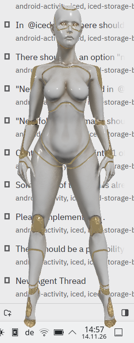

# Riggy

Bring your AI agent to life as a mascot figure or just use it in your creative project: an animated character living in your tray or on your desktop and speaking with a self-hosted TTS server.

> [!NOTE]
> Built and tested only on Linux, KDE Plasma 6 and Nvidia T1000 4GB VRAM GPU: weak hardware, but almost instant high quality outputs in default configuration!

## Screenshots 📷



<details><summary>License note of the avatar model on the screenshots</summary>
["Cyborg girl" by 3dchmoshnik](https://www.fab.com/listings/78cf53b9-75d0-4731-b59b-5bb4ededde54), licensed under CC BY 4.0.
</details>

## Quick start 🚀

### 0. Install/use Nix

Riggy comes as a Nix flake. On NixOS, switch on flakes in your configuration:

```nix
nix.settings.experimental-features = [ "nix-command" "flakes" ];
```

On other Linux distributions, install Nix as described on [nixos.org/download](https://nixos.org/download/).

### 1. Install the flake

On NixOS, add Riggy to your system flake. This also runs the speech server:

```nix
# flake inputs
riggy.url = "github:Santuzius/riggy";

# configuration
imports = [ inputs.riggy.nixosModules.default ];
services.riggy.enable = true;
```

Then rebuild your system, e.g. with `sudo nixos-rebuild switch`.

On other distributions, `nix profile add github:Santuzius/riggy` installs Riggy; the speech server is then started by hand as [qwentts-nix](https://github.com/Santuzius/qwentts-nix) describes, on port 8902.

### 2. Install models

Models are not part of the repository.

#### TTS

The default TTS model is [Serveurperso/Qwen3-TTS-GGUF from the Hugging Face](https://huggingface.co/Serveurperso/Qwen3-TTS-GGUF).

<details><summary>Its license note</summary>
[Serveurperso/Qwen3-TTS-GGUF](https://huggingface.co/Serveurperso/Qwen3-TTS-GGUF), licensed under Apache-2.0.
</details>

Download `qwen-talker-0.6b-customvoice-Q8_0.gguf` and `qwen-tokenizer-12hz-Q8_0.gguf`. Then install them using:

```bash
riggy install ~/Downloads/qwen-talker-0.6b-customvoice-Q8_0.gguf ~/Downloads/qwen-tokenizer-12hz-Q8_0.gguf
```

#### Avatars

The default avatar is [3dchmoshnik's "Cyborg girl" from the Fab](https://www.fab.com/listings/78cf53b9-75d0-4731-b59b-5bb4ededde54).

<details><summary>Its license note</summary>
["Cyborg girl" by 3dchmoshnik](https://www.fab.com/listings/78cf53b9-75d0-4731-b59b-5bb4ededde54), licensed under CC BY 4.0.
</details>

Download it in the GLB format and then install using:

```bash
riggy install ~/Downloads/cyborg_girl/cyborg_girl.glb
```

Other avatars in GLB format are installed the same way and appear in the tray menu under their file name. Each needs a mapping file that tells Riggy its bones and mouth shapes; see [doc/avatars.md](doc/avatars.md).

### 3. Start

Start Riggy using the entry from your start menu. From then on it starts at login by itself.

### Done! 🎉

#### Try it out 👀

```bash
riggy say "Hello, my name is Riggy"
```

`--language German` (or `auto`) speaks other languages.

#### Integrate as MCP 🤖

E.g. for Claude Code:

```bash
claude mcp add --scope user riggy-mcp riggy-mcp
```

The agent gets the tool `speak(text, language)`, and its replies come out of Riggy's mouth.

#### Customize 🎛️

All you need is reachable through the tray:

- Switch TTS or Avatar on/off
- Select avatar
- Select TTS voice or tempo
- Select lip sync method
- Desktop: enable dragging/click-through, size, view (whole figure to face) and turn
- Enable autostart at login or when an AI agent starts `riggy-mcp`
- Open files for advanced configuration in your default editor

[doc/usage.md](doc/usage.md) explains each entry, the lip sync methods and the settings files.

## Development 🛠️

```bash
nix develop        # or `direnv allow` once
cargo run          # the avatar in a normal window, with the defaults from the checkout
cargo test
```

The Rust toolchain comes from rustup (`rust-toolchain.toml`); the Nix shell adds Bevy's native libraries and the tools of the lip sync methods. The package holds three programs: the avatar `riggy`, the tray icon `riggy-tray` and the MCP server `riggy-mcp`.

- [doc/development.md](doc/development.md): live reloading, debug keys, screenshots and lip sync tuning
- [doc/interfaces.md](doc/interfaces.md): the speech and control sockets and the MCP server
- [doc/avatars.md](doc/avatars.md): mapping files for new avatars

## Tips 💡

- The speech server takes a few seconds to load its model after login; the tray's tooltip says "Speech starting…" until then.
- Switching speech off in the tray frees the GPU memory of the speech server.
- With click-through off, drag Riggy with the left mouse button and zoom with the mouse wheel.

## License 📄

Riggy's source is MIT-licensed. The default package links eSpeak NG (GPL-3.0-or-later) for the lip sync method "From the text", so that build is GPL-3.0-or-later as a whole:

| Package | Lip sync methods | License of the build |
|---|---|---|
| `github:Santuzius/riggy` | sound, Rhubarb, text | GPL-3.0-or-later |
| `github:Santuzius/riggy#riggy-mit` | sound, Rhubarb | MIT |
| `github:Santuzius/riggy#riggy-minimal` | sound | MIT |

`src/lipsync/rhubarb_animation/` is a port of [Rhubarb Lip Sync](https://github.com/DanielSWolf/rhubarb-lip-sync)'s animation rules under their MIT license (`LICENSE` in that folder). Models are not part of Riggy and keep their own licenses.

Built with [Bevy](https://bevy.org), [Rhubarb Lip Sync](https://github.com/DanielSWolf/rhubarb-lip-sync), [eSpeak NG](https://github.com/espeak-ng/espeak-ng) and [qwentts.cpp](https://github.com/ServeurpersoCom/qwentts.cpp).
